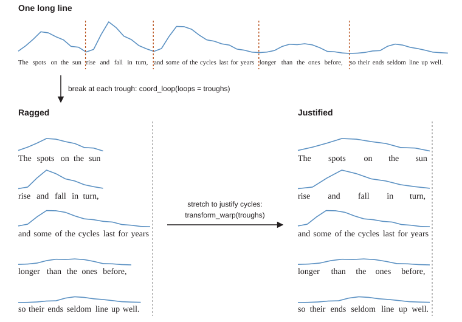
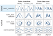

```{r setup, include = FALSE}
knitr::opts_chunk$set(
  collapse = TRUE,
  comment = "#>",
  message = FALSE,
  fig.width = 3.8,
  fig.height = 3,
  fig.show = "hold",
  out.width = "49%"
)
```

Many time series have patterns that repeat, but not always over the same length of time. Sunspot numbers rise and fall in *cycles* lasting between nine and fourteen years. *Seasonal* patterns repeat over common calendar granules such as days and years. These granules also vary in length because leap years have an extra day and daylight saving gives some days 23 or 25 hours.

Looping a time series draws each repetition over the last, making them easier to compare. When the repetitions vary in length, we also need to choose how to line them up. This vignette shows how to make that choice with ggtime, and what each choice reveals.

```{r packages, warning = FALSE}
library(ggplot2)
library(ggtime)
library(dplyr)
library(mixtime, warn.conflicts = FALSE)

theme_set(theme_minimal())
```

## Cycles of different lengths

Sunspots are dark spots on the sun that become more and less common about every eleven years. We'll look at eight cycles from 1766 to 1855, each starting from a trough.

```{r sunspot-data}
troughs <- year(c(1766L, 1775L, 1784L, 1798L, 1810L, 1823L, 1833L, 1843L, 1856L))

sunspots <- tibble(
  Year = year(1766:1855),
  Sunspots = as.numeric(window(sunspot.year, 1766, 1855))
)

sunspot_plot <- ggplot(sunspots, aes(Year, Sunspots)) +
  geom_time_line()
```

Since cycles last about eleven years, we could try looping every eleven years with `coord_loop()`.

```{r sunspot-fixed, fig.alt = c("Line chart of yearly sunspot numbers, with eight peaks of varying height and spacing.", "Sunspot numbers looped every eleven years. The peaks are spread across the whole panel.")}
sunspot_plot + labs(title = "Linear")
sunspot_plot +
  coord_loop(time_loops = years(11L)) +
  labs(title = "Looped every 11 years")
```

The peaks are scattered, because eleven years is only the average length. Instead, we can give the troughs to `loops`, so that each loop starts a new cycle. Adding `transform_warp()` to the scale then stretches or compresses the cycles to the same width.

```{r sunspot-loop, fig.alt = c("Ragged sunspot cycles, which start together and end between 9 and 14 years later.", "Justified sunspot cycles, all stretched to the same width. The strongest cycles peak before the middle of the panel.")}
ragged <- sunspot_plot +
  labs(title = "Ragged") +
  scale_x_mixtime(time_breaks = years(4L))
justified <- sunspot_plot +
  labs(title = "Justified") +
  scale_x_mixtime(transform = transform_warp(troughs))

ragged + coord_loop(loops = troughs)
justified + coord_loop(loops = troughs)
```

Like lines of text, cycles can be left *ragged* or *justified* to a common width. Looping adds the line breaks, and warping stretches each line to fit. Ragged axes show the time since the start of each cycle, and justified axes show the proportion of the cycle.

```{r text-alignment, echo = FALSE, out.width = "100%", fig.alt = "A long line of text under the sunspot series is broken at each trough, giving ragged lines of different lengths. The lines are then stretched to a common width, giving justified lines."}

```

The loops can also be drawn around a circle with `coord_radial()`. Shorter ragged cycles stop before completing the circle, while justified cycles all go around exactly once.

```{r sunspot-radial, fig.width = 4.2, fig.height = 3.8, fig.alt = c("Ragged sunspot cycles in radial coordinates, where short cycles stop before completing the circle.", "Justified sunspot cycles in radial coordinates, where every cycle completes the circle.")}
ragged + coord_loop(loops = troughs, coord = coord_radial())
justified + coord_loop(loops = troughs, coord = coord_radial())
```

## Aligning daylight saving time

People follow local time, but clocks can change. Daylight saving starts in Melbourne on the first Sunday in October, when clocks skip from 2am to 3am. We'll look at hourly pedestrian counts at Southern Cross Station on the Sundays and Mondays from three weeks before to three weeks after the change in 2015.

```{r station-data}
station <- tsibble::pedestrian |>
  filter(
    Sensor == "Southern Cross Station",
    Date >= "2015-09-13", Date <= "2015-10-26",
    day_of_week(Date) %in% c("Sun", "Mon")
  ) |>
  mutate(Time = mixtime(Date_Time))

station_plot <- ggplot(station, aes(Time, Count, colour = factor(Date))) +
  geom_time_line() +
  facet_wrap(vars(weekdays(Date)), ncol = 1, scales = "free_y") +
  scale_colour_viridis_d(end = 0.85, guide = "none")
```

We'd like to loop over days, but how long is a day? Without daylight saving, every day is 24 hours long. To see what happens if we ignore it, we can set the `time_chronon` of the scale to use `"Australia/Brisbane"` time. Brisbane shares Melbourne's standard time (UTC+10) but never changes its clocks.

```{r station-offset, fig.width = 7.6, fig.height = 4, out.width = "100%", fig.alt = "Pedestrian counts looped over days in Brisbane. The Mondays have the same two rush hour peaks, but after the clocks change they are an hour earlier."}
station_plot +
  scale_x_mixtime(
    time_chronon = hour(1L, tz = "Australia/Brisbane")
  ) +
  coord_loop(time_loops = days(1L))
```

The pattern is **offset** once daylight saving starts. Commuters arrive at the same time each Monday on Melbourne's clocks, but after the change their rush hours appear an hour earlier on this scale. Sundays are less regular, so the offset is harder to see.

Without a `time_chronon`, the scale uses the time zone of the data. Our data is in Melbourne time, so `days(1L)` now loops from midnight to midnight in Melbourne. If the data were stored in UTC, the Mondays would still be misaligned.

```{r station-zoned, fig.width = 7.6, fig.height = 4, out.width = "100%", fig.alt = "Pedestrian counts looped over Melbourne days. The Mondays line up, but the Sunday when clocks change is an hour early and its line ends early."}
station_plot +
  coord_loop(time_loops = days(1L))
```

This aligns the Mondays, but not the Sunday when clocks change. Its loop starts at the right time, but the scale measures *absolute* time: the hours that have passed since midnight. Only two hours had passed by 3am, so the rest of the day is drawn an hour too early. The day is 23 hours long, so its line ends early and the days are ragged.

To fix this, we change the scale rather than the loop. A `time_chronon` without a time zone (`tz = NA`) measures *local* time, as shown on the clock.

```{r station-aligned, fig.width = 7.6, fig.height = 4, out.width = "100%", fig.alt = "Pedestrian counts looped over days in local time. The Mondays and Sundays line up, with a dashed line between 2am and 3am on the Sunday when clocks change."}
station_plot +
  scale_x_mixtime(time_chronon = hour(1L, tz = NA)) +
  coord_loop(time_loops = days(1L))
```

Every day now has 24 hours on the clock, so all of the days are **aligned**. The skipped hour is drawn as a dashed line.

## Recap

The scale decides how time is measured, and the coordinates decide how it is laid out: along a line, in loops, or in the rows of a calendar (`coord_calendar()`). Any scale can be combined with any coordinates.

```{r recap, echo = FALSE, out.width = "85%", fig.align = "center", fig.alt = "A grid of small sketched plots. The rows are Cartesian, looped Cartesian, looped radial, and calendar coordinates. The columns are identity and warped transformations, which give ragged and justified arrangements, then absolute and local time zones, which give offset and aligned arrangements."}

```
